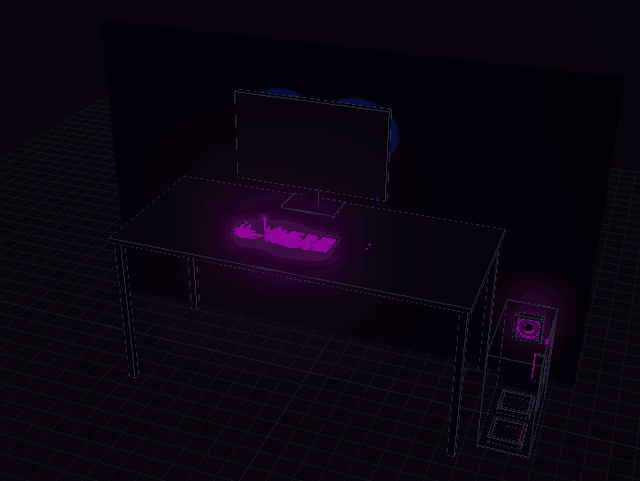

# RGB Studio

A simpler way to light up a PC with [OpenRGB](https://openrgb.org). Pick a look, and every fan, RAM stick, keyboard, mouse and monitor light shows it in sync. Colors flow through your setup by where each light physically is, not by device.


- **Looks:** 21 ready-made scenes (Synthwave, Aurora, Lava Lamp, Storm, Comet, Matrix and more), each one editable: pick the motion, colors, speed, brightness, gradient width and how much the dark gaps glow. Give the desk its own look, or run one look across everything.
- **Motions:** flow, bounce, breathe, twinkle, comet, drift, beam, bubbles, lightning and fill.
- **Saved looks:** name and save everything about a look: the case and desk looks, motion, speed and every other setting, whether colors travel together or separately and in which direction, Empty space, and any device running its own built-in effect. Click a saved look to bring it back. Looks are switched in the editor, not from the tray.
- **Your setup in 3D:** your case, desk and monitor, lit live. Drag each light to where it really sits, move and turn the case, and pick which way colors travel: up, across, out from the center, or in a spiral around the case. Colors can travel across the whole rig together (rising from the case on the floor up through the desk and monitor, say) or separately for the case and the desk. Lights on the back of a monitor glow on the wall behind it.
- **Save to PC:** a small tray player keeps your look playing, in sync, after the editor closes. Pick still colors for when you're not using it.

## Why RGB Studio: it stays out of the way

Most RGB apps keep a large program running all day to work out every frame. RGB Studio splits the job in two. The editor runs only while you're changing your look, and it quits about 15 seconds after you close its tab. Then a small tray player replays the recorded look. Each frame is worked out ahead of time, so the player only reads the next one and sends it to OpenRGB. There's no web engine, account, ads or internet connection; the only time it goes online is when you click **Check for updates**.

Measured on the author's PC over 20 seconds while the player animated a look (Ryzen 9 7950X3D, 8 devices, 267 LEDs, 20 frames a second):

| What's running | CPU | Memory |
|---|---|---|
| RGB Studio player | 0.02% of the PC (about 0.5% of one core) | 30 MB |
| RGB Studio editor | Nothing once its tab is closed | Nothing once its tab is closed |

Compared with the alternatives:

- **[SignalRGB](https://signalrgb.com)** works out its effects live with a built-in web engine for as long as it runs. Users have reported [10–25% CPU from that engine](https://forum.signalrgb.com/t/high-cpu-usage-from-qtwebengine-signal/3132), [up to 47% in games](https://forum.signalrgb.com/t/insane-cpu-usage-while-in-game/3029), and [memory that keeps climbing](https://forum.signalrgb.com/t/signal-still-has-a-big-memory-leak-issue/8990), and its docs have a page on [memory leaks](https://docs.signalrgb.com/troubleshooting/common-issues/memory-leaks/). It supports far more devices and effects, so it's the bigger tool if you need those.
- **[OpenRGB Effects Plugin](https://openrgb.org/plugins)** runs inside the OpenRGB app, so that app has to stay open (minimized is fine). OpenRGB 1.1's background service doesn't load plugins. Older reports describe [8–10% CPU while animating](https://gitlab.com/CalcProgrammer1/OpenRGB/-/work_items/2557) on some hardware, and [more at higher frame rates](https://gitlab.com/OpenRGBDevelopers/OpenRGBEffectPlugin/-/issues/19).

These numbers come from different PCs and versions, so treat them as a rough guide, not a benchmark. Whichever app drives your lights, OpenRGB itself also does some work to send each frame to the devices, and that isn't counted in the table.

## Requirements

- Windows 10 or 11, with [OpenRGB](https://openrgb.org) 0.9 or newer (see below).
- Nothing else. Node.js is bundled in the installer and the zip.

## Set up OpenRGB

RGB Studio talks to your lights through OpenRGB, so set that up first:

1. **Install [PawnIO](https://pawnio.eu).** OpenRGB uses this driver to reach RAM lighting and some motherboards.
2. **Install OpenRGB** with the Windows installer (`.msi`) from [openrgb.org](https://openrgb.org/releases.html), and keep the option to install it as a **background service**. The service starts with Windows, runs as administrator so PawnIO works, and listens on port 6742, which is where RGB Studio connects. You don't need to keep the OpenRGB window open.
3. **Check your devices.** Open OpenRGB once and make sure everything shows up. If something is missing, see OpenRGB's [Windows setup guide](https://gitlab.com/OpenRGBDevelopers/OpenRGB-Wiki/-/blob/stable/User-Documentation/OpenRGB-Windows-Setup-and-Usage.md). Then close the window. If it opens by itself when Windows starts, turn that off in Task Manager under **Startup apps**; the service keeps running either way.

Not using the service? Run OpenRGB as administrator and start its SDK server (the **SDK Server** tab), and leave it open while you use RGB Studio.

## Install RGB Studio

First, [set up OpenRGB](#set-up-openrgb) (step 1 above). Then pick one:

**Installer (recommended).** Download `RGBStudioSetup-X.Y.Z.exe` from [Releases](https://github.com/michaelbystryk/rgb-studio/releases) and run it. You don't need Node, and you don't need administrator rights. It adds a Start menu entry, and you can remove it any time from **Settings → Apps**. It never starts with Windows on its own.

**Portable zip.** Download `rgb-studio-X.Y.Z.zip` from Releases and unzip it anywhere. Node is already inside. Double-click `start.cmd` (or `player\RGBStudio.exe`).

**"Windows protected your PC"?** RGB Studio isn't code-signed, so SmartScreen may warn you the first time. Click **More info**, then **Run anyway**.

## Run it

Open **RGB Studio** from the Start menu. This opens http://127.0.0.1:6750 in your browser. RGB Studio only listens on your own PC.

The first time, a short setup guide checks OpenRGB, finds your devices and walks through where each light is; run it again any time from **Your setup → Run setup again**.

It runs through `player\RGBStudio.exe`, so there's no console window. It shows up as "RGB Studio" with the logo in Task Manager, and ending it there ends the editor too. Its output goes to `%APPDATA%\RGB Studio\editor.log`.

The editor closes by itself about 15 seconds after you close the tab. Run `player\RGBStudio.exe --keep-alive` to keep it running.

Your settings and saved looks live in `%APPDATA%\RGB Studio`. The first time you run a new version, they're copied there once from an older version's folder.

To update, use **Check for updates** in the tray player's menu, or download the new installer and run it over the old one. Your looks stay.

## From a clone / development

You only need this to work on the code. The editor runs on [Node.js](https://nodejs.org) 20 or newer:

1. Go to [nodejs.org](https://nodejs.org) and download the Windows installer (`.msi`) for the **LTS** version.
2. Run it and keep the default options. You can leave **Automatically install the necessary tools** unticked; RGB Studio doesn't need them.
3. To check it worked, open a new Command Prompt or PowerShell window and run `node -v`. It should print `v20` or higher.

**Or install it from PowerShell.** Windows 10 and 11 include `winget`, so one command does it:

```powershell
winget install --id OpenJS.NodeJS.LTS --exact --accept-source-agreements --accept-package-agreements
```

Then open a new PowerShell window, so it picks up Node. If `start.cmd` can't find Node right after installing, sign out of Windows and back in, then try again.

Then, in the clone:

```
npm install
npm start
```

Or double-click `start.cmd`. Run `node server.js --keep-alive` to keep the editor running after the tab closes. Build the exes with `player\build.cmd`.

## Making a release

For the maintainer:

1. Bump `version` in `package.json` and commit.
2. Run `node tools/build-release.js`. It bundles Node, builds the exes, and writes `dist\rgb-studio-X.Y.Z.zip` and `dist\RGBStudioSetup-X.Y.Z.exe`. The installer needs [Inno Setup 6](https://jrsoftware.org/isinfo.php); without it you get just the zip. Pass `--no-installer` to skip it on purpose.
3. Or let GitHub do it: push a tag like `v1.2.3` (it must match `package.json`). The release workflow builds both files and attaches them to a **draft** release.
4. Check the draft on GitHub and publish it.

To change the bundled Node, edit `NODE_VERSION` and its SHA256 at the top of `tools/build-release.js`.

## Fine-tune a look

Pick a scene, then change anything about it: the motion, the colors in order, speed, brightness, how wide the gradient is, and how much the dark gaps glow. Tune the case and the desk separately, or the whole rig at once.


## Keeping your lights after it closes

The editor draws your look live, so it stops when the editor closes. **Save to PC** records it for the player:

- **The player** (`player\RGBStudioPlayer.exe`) is a small app with an icon in your taskbar tray. It plays your saved look, in sync across every device, and picks up new saves by itself. While the editor is open it waits, then takes over again once you close it. Its menu has **Open editor**, **Play saved look** or **Show still colors**, **Check for updates**, **Start with Windows** (off until you turn it on), and **Exit**.
- **Still colors** are what your lights show when you're not using them: when you pick **Show still colors** in the player's menu, after you exit the player, and while your PC starts. Pick a color or a gradient for the case and for the desk, or freeze a snapshot of your look. RGB Studio stores them on devices that support it and in an OpenRGB profile named "RGB Studio". To show them after a restart or sleep as well, the save dialog offers to make that the OpenRGB service's startup profile. With OpenRGB 1.1 or newer that takes one click; older versions ask for administrator rights once.


The player and the editor launcher (`RGBStudio.exe`) are built with `player\build.cmd`, which uses the C# compiler that comes with Windows. The player needs only OpenRGB. The files it plays are described in [docs/player-format.md](docs/player-format.md).

## The 3D view

It's a full 3D editor of your setup: turn around it, zoom in, and drag any light to where it really sits.



| Do this | To |
| --- | --- |
| Drag a light | move it along the surface it's mounted on |
| Click the case, then drag it | move the case (turn it in the sidebar) |
| Drag empty space, or middle-drag | orbit |
| Right-drag, or Shift + drag | pan |
| Scroll | zoom toward the pointer |

## Line up each light

Click a light in the 3D view, or pick it from the list, to set where it's mounted and which way its LEDs run.


- **Identify** blinks that light white on your PC, so you know which fan or strip it is.
- **Show first LED** (fans) lights the fan's first LED in white with pink trailing after it, on your PC and in the 3D view. If the two don't match, fix it with the buttons below.
- **Reverse** flips which way the LEDs run. Use it when colors circle a fan the wrong way, or flow down a RAM stick when they should rise.
- **Upside down** (fans) turns the fan's lights half a turn, for when effects start from the wrong edge. **Turn lights °** does the same in smaller steps.
- **Nothing connected** hides a header or channel with nothing plugged into it.

## Describe your own setup

Device names and LED counts come from OpenRGB, but RGB Studio can't know where you mounted things. Drag lights in the 3D view, or use **Share / import** in the sidebar:

- **Copy** gives you your layout as JSON, to back up or share.
- **Ask Claude** copies a ready-made prompt with your layout. Paste it into Claude (or another assistant), describe your build in plain words ("three front intake fans, two top exhaust, RGB strip under the desk"), and paste the reply back into **Import**.

The format is described in [docs/rig-format.md](docs/rig-format.md).

## How it works

```
server.js              local web server, effect loop and API
src/openrgb.js         OpenRGB SDK client (protocol 5, plus profiles and settings on 6; no dependencies)
src/effects.js         scenes, and the renderer that turns LED positions into colors
src/rig.js             default positions for each kind of device, and rig validation
src/persist.js         stores still colors on devices and in the OpenRGB profile
src/player-export.js   Save to PC: records each look as a seamless loop for the player
player/                the tray player and the editor launcher (C#, built with player\build.cmd)
installer/             the Inno Setup script for the installer
tools/build-release.js builds the portable zip and the installer (see Making a release)
.github/workflows/     builds a draft release when a version tag is pushed
tools/make-icon.js     draws public/favicon.ico, the logo used by the exes and the browser tab
src/startup.js         sets the OpenRGB service's startup profile (over the SDK, or tools/set-startup-profile.js on older OpenRGB)
shared/rig-geometry.js where each LED sits, shared by the server and the 3D view
public/                the page, including the three.js rig view
tools/probe.js         prints every device, zone and mode OpenRGB reports (npm run probe)
```

Settings and your layout are saved to `%APPDATA%\RGB Studio`.

Some effects are inspired by ideas from [OpenRGBEffectsPlugin](https://gitlab.com/OpenRGBDevelopers/OpenRGBEffectsPlugin); no code is taken from it.

## License

[MIT](LICENSE)
