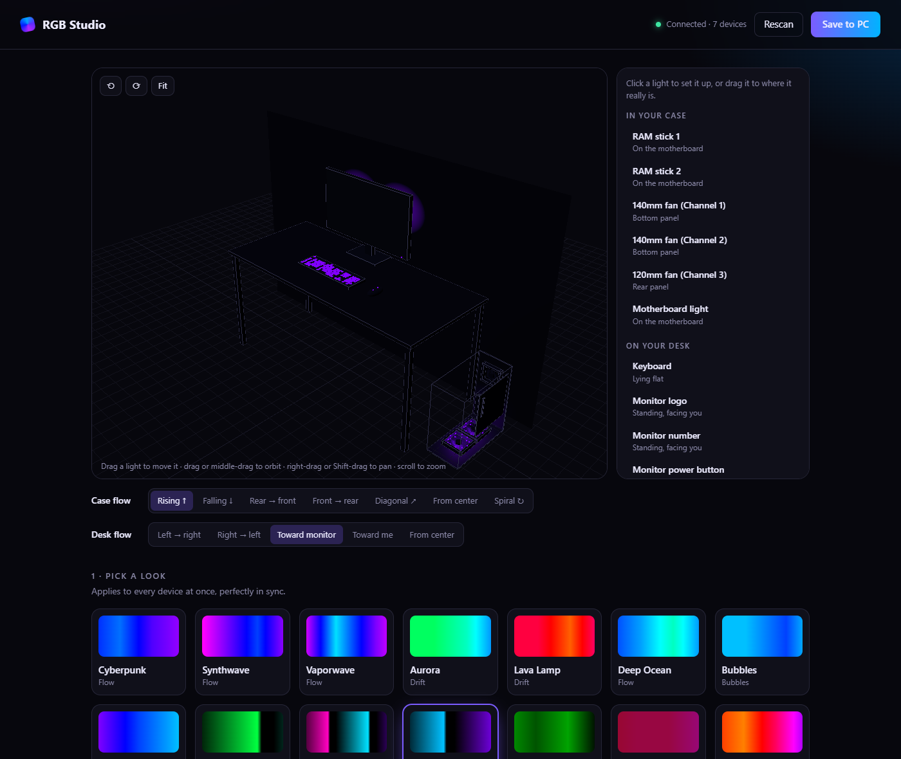
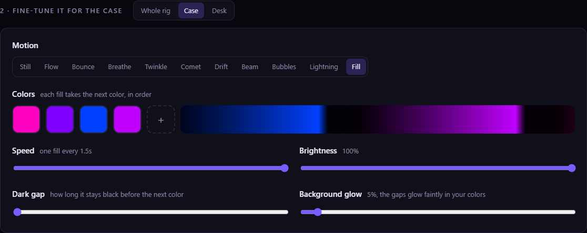
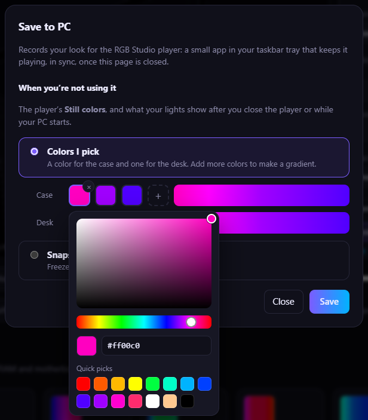
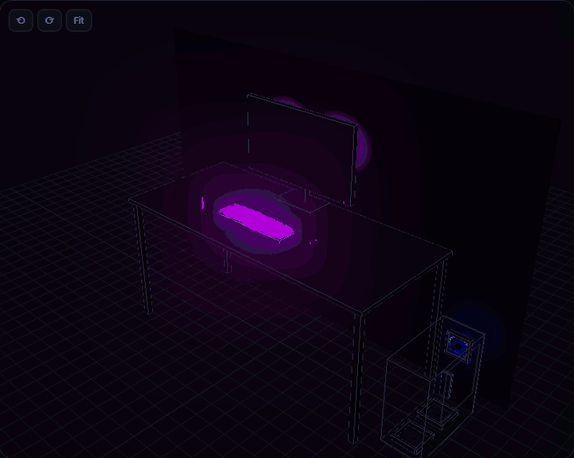
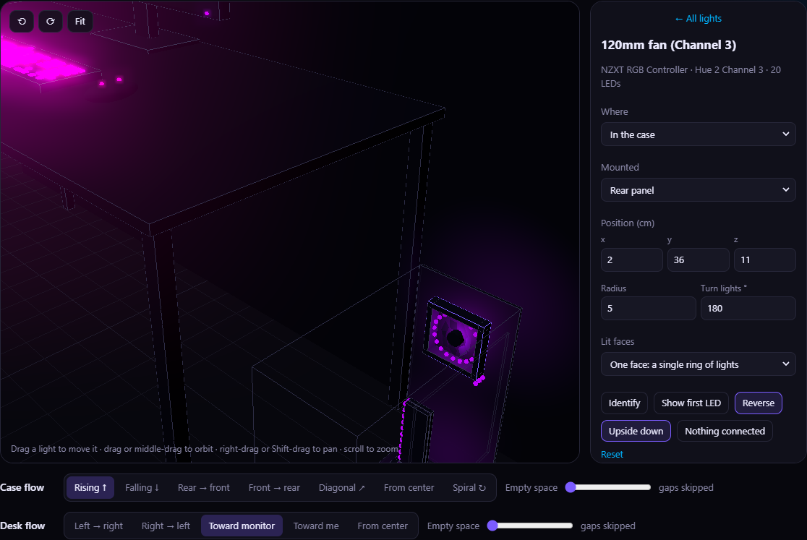

# RGB Studio

A simpler way to light up a PC with [OpenRGB](https://openrgb.org). Pick a look, and every fan, RAM stick, keyboard, mouse and monitor light shows it in sync. Colors flow through your setup by where each light physically is, not by device.



- **Looks:** 21 ready-made scenes (Synthwave, Aurora, Lava Lamp, Storm, Comet, Matrix and more), each one editable: pick the motion, colors, speed, brightness, gradient width and how much the dark gaps glow. Give the desk its own look, or run one look across everything.
- **Motions:** flow, bounce, breathe, twinkle, comet, drift, beam, bubbles, lightning and fill.
- **Your setup in 3D:** your case, desk and monitor, lit live. Drag each light to where it really sits, move and turn the case, and pick which way colors travel: up, across, out from the center, or in a spiral around the case. Lights on the back of a monitor glow on the wall behind it.
- **Save to PC:** a small tray player keeps your look playing, in sync, after the editor closes. Pick still colors for when you're not using it.

## Requirements

- Windows, with [OpenRGB](https://openrgb.org) 0.9 or newer (see below).
- [Node.js](https://nodejs.org) 20 or newer, for the editor. The tray player doesn't need it.

## Set up OpenRGB

RGB Studio talks to your lights through OpenRGB, so set that up first:

1. **Install [PawnIO](https://pawnio.eu).** OpenRGB uses this driver to reach RAM lighting and some motherboards.
2. **Install OpenRGB** with the Windows installer (`.msi`) from [openrgb.org](https://openrgb.org/releases.html), and keep the option to install it as a **background service**. The service starts with Windows, runs as administrator so PawnIO works, and listens on port 6742, which is where RGB Studio connects. You don't need to keep the OpenRGB window open.
3. **Check your devices.** Open OpenRGB once and make sure everything shows up. If something is missing, see OpenRGB's [Windows setup guide](https://gitlab.com/OpenRGBDevelopers/OpenRGB-Wiki/-/blob/stable/User-Documentation/OpenRGB-Windows-Setup-and-Usage.md). Then close the window. If it opens by itself when Windows starts, turn that off in Task Manager under **Startup apps**; the service keeps running either way.

Not using the service? Run OpenRGB as administrator and start its SDK server (the **SDK Server** tab), and leave it open while you use RGB Studio.

## Run it

Double-click `start.cmd`, or:

```
npm install
npm start
```

This opens http://127.0.0.1:6750 in your browser. RGB Studio only listens on your own PC.

The editor closes by itself about 15 seconds after you close the tab. Run `node server.js --keep-alive` to keep it running.

## Fine-tune a look

Pick a scene, then change anything about it: the motion, the colors in order, speed, brightness, how wide the gradient is, and how much the dark gaps glow. Tune the case and the desk separately, or the whole rig at once.



## Keeping your lights after it closes

The editor draws your look live, so it stops when the editor closes. **Save to PC** records it for the player:

- **The player** (`player\RGBStudioPlayer.exe`) is a small app with an icon in your taskbar tray. It plays your saved look, in sync across every device, and picks up new saves by itself. While the editor is open it waits, then takes over again once you close it. Its menu has **Open editor**, **Animated look** or **Still colors**, **Start with Windows** (off until you turn it on), and **Close**.
- **Still colors** are what your lights show when you're not using them: from the player's menu, after you close the player, and while your PC starts. Pick a color or a gradient for the case and for the desk, or freeze a snapshot of your look. RGB Studio stores them on devices that support it and in an OpenRGB profile named "RGB Studio". To show them after a restart or sleep as well, the save dialog offers to make that the OpenRGB service's startup profile. With OpenRGB 1.1 or newer that takes one click; older versions ask for administrator rights once.



To build the player, run `player\build.cmd`. It uses the C# compiler that comes with Windows, so there's nothing to install. The player needs only OpenRGB. The files it plays are described in [docs/player-format.md](docs/player-format.md).

## The 3D view

It's a full 3D editor of your setup: turn around it, zoom in, and drag any light to where it really sits.



| Do this | To |
| --- | --- |
| Drag a light | move it along the surface it's mounted on |
| Click the case, then drag it | move the case (turn it in the sidebar) |
| Drag empty space, or middle-drag | orbit |
| Right-drag, or Shift + drag | pan |
| Scroll | zoom toward the pointer |

## Line up each light

Click a light in the 3D view, or pick it from the list, to set where it's mounted and which way its LEDs run.



- **Identify** blinks that light white on your PC, so you know which fan or strip it is.
- **Show first LED** (fans) lights the fan's first LED in white with pink trailing after it, on your PC and in the 3D view. If the two don't match, fix it with the buttons below.
- **Reverse** flips which way the LEDs run. Use it when colors circle a fan the wrong way, or flow down a RAM stick when they should rise.
- **Upside down** (fans) turns the fan's lights half a turn, for when effects start from the wrong edge. **Turn lights °** does the same in smaller steps.
- **Nothing connected** hides a header or channel with nothing plugged into it.

## Describe your own setup

Device names and LED counts come from OpenRGB, but RGB Studio can't know where you mounted things. Drag lights in the 3D view, or use **Share / import** in the sidebar:

- **Copy** gives you your layout as JSON, to back up or share.
- **Ask Claude** copies a ready-made prompt with your layout. Paste it into Claude (or another assistant), describe your build in plain words ("three front intake fans, two top exhaust, RGB strip under the desk"), and paste the reply back into **Import**.

The format is described in [docs/rig-format.md](docs/rig-format.md).

## How it works

```
server.js              local web server, effect loop and API
src/openrgb.js         OpenRGB SDK client (protocol 5, plus profiles and settings on 6; no dependencies)
src/effects.js         scenes, and the renderer that turns LED positions into colors
src/rig.js             default positions for each kind of device, and rig validation
src/persist.js         stores still colors on devices and in the OpenRGB profile
src/player-export.js   Save to PC: records each look as a seamless loop for the player
player/                the tray player (C#, built with player\build.cmd)
src/startup.js         sets the OpenRGB service's startup profile (over the SDK, or tools/set-startup-profile.js on older OpenRGB)
shared/rig-geometry.js where each LED sits, shared by the server and the 3D view
public/                the page, including the three.js rig view
tools/probe.js         prints every device, zone and mode OpenRGB reports (npm run probe)
```

Settings and your layout are saved to `settings.json` next to `server.js`.

Some effects are inspired by ideas from [OpenRGBEffectsPlugin](https://gitlab.com/OpenRGBDevelopers/OpenRGBEffectsPlugin); no code is taken from it.

## License

[MIT](LICENSE)
